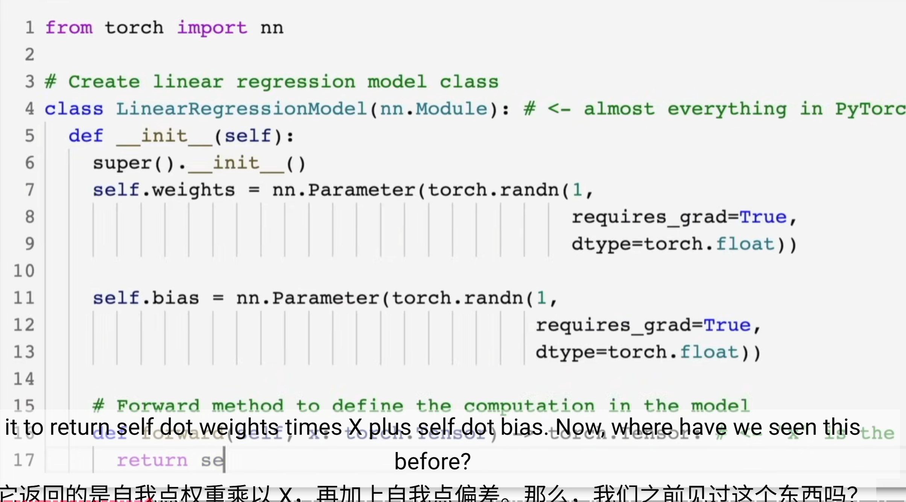

# 基线代码解释能力记录

在正式学习前，选择一小段与深度学习或 PyTorch 相关的代码，尝试独立解释。

## 代码截图



## 代码片段

```python
def plot_predictions(train_data=X_train,
                     train_labels=y_train,
                     test_data=X_test,
                     test_labels=y_test,
                     predictions=None):
  plt.figure(figsize=(10, 7))
  # Plot training data in blue
  plt.scatter(train_data, train_labels, c='r', s=4, label='Training data')
  # Plot test data in green
  plt.scatter(test_data, test_labels, c='g', s=4, label='Testing data')
  # Are there predictions?
  if predictions is not None:
    plt.scatter(test_data, predictions, c='r', s=4, label='Predictions')
  # Show the legend
  plt.legend(prop={'size': 14});
```

## 我的解释

这里应该是做一个 PyTorch 里的函数画布，就是把 train 和 test 结果放在空间直角坐标系中。如果有 prediction，就再画一个 predictions，最后添加图例。

## 我不确定的地方

- `def plot_predictions` 这里面的 `plot_predictions` 是关键字吗？
- `legend prop` 不知道是什么。
- `scatter` 里面还有哪些参数？

## AI 追问后暴露的问题

- 待填写。

