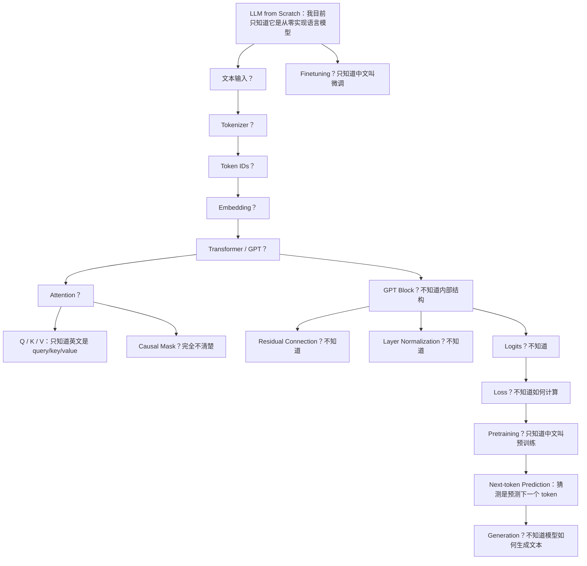

# Week 0 初始知识图谱：问题版

日期：2026-06-04

## 为什么这张图可以“不正确”

这张图不是标准答案，而是学习前的真实起点。  
我目前对 LLM from Scratch 的整体逻辑还不清楚，所以这张图用“问题”和“不确定连接”来记录当前状态。

8 周后，这张图会和 `week8_final_llm_map.md` 对比，用来证明我的理解结构如何变化。

## 初始问题图谱

## 我目前确定知道的内容

- LLM 和语言模型有关。
- Q/K/V 分别是 query、key、value，但不知道它们如何计算。
- next-token prediction 大概和预测下一个 token 有关。
- pretraining 是预训练，finetuning 是微调，但目前只停留在中文翻译层面。

## 我目前不确定的连接

| 连接 | 当前状态 |
|---|---|
| 文本如何变成 token ids | 不知道 |
| token ids 如何变成 embedding | 不知道 |
| embedding 为什么需要位置信息 | 不知道 |
| attention 如何计算相关性 | 不知道 |
| causal mask 为什么对 GPT 重要 | 不知道 |
| GPT block 内部有哪些结构 | 不知道 |
| logits、targets、loss 如何连接 | 不知道 |
| pretraining 如何让模型学会生成 | 不知道 |
| generation 和 training 有什么不同 | 不知道 |

## 第 8 周回看时要回答的问题

1. 我能否解释文本从原始字符串进入模型的完整路径？
2. 我能否解释 token embedding 和 positional embedding 的区别？
3. 我能否画出 attention 的输入、输出和 shape？
4. 我能否解释 GPT block 的主要结构？
5. 我能否解释 next-token prediction、logits、targets、loss 的关系？
6. 我能否解释模型生成重复或无意义文本的原因？

