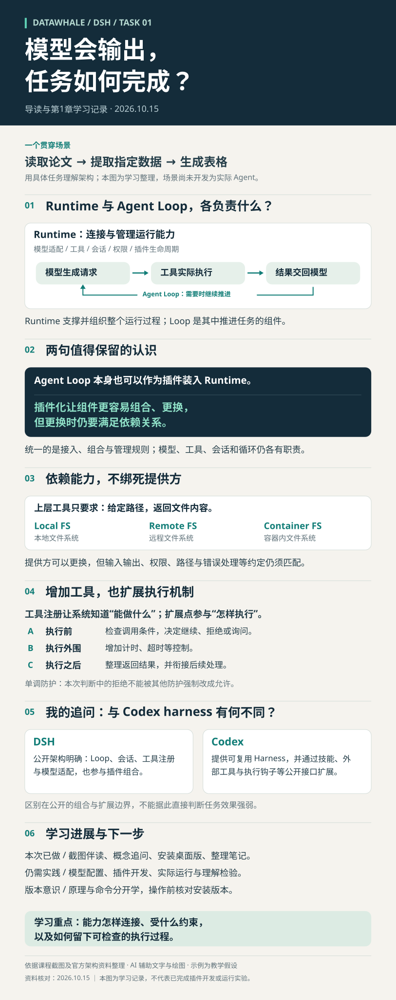

# 模型会输出，任务如何完成？

## Datawhale DSH Task1｜导读与第1章学习记录

学习日期：2026年10月15日。主题：为什么需要Harness，以及“一切皆插件”究竟改变了什么。

[查看矢量学习记录图](assets/task1-learning-record.svg) · [课程入口](https://www.datawhale.cn/learn/summary/381)

展开一图总览：我的概念整理与追问

本次学习围绕课程截图、两个具体追问和一个贯穿例子展开。我接触过一些大模型数学内容，计算机系统与软件工程基础仍在补充。因此，比起先背一串组件名称，我更需要弄清楚：当我要求AI读取论文并生成表格时，究竟是谁在执行，谁在组织，结果又怎样交回模型？

## 一、从“模型生成输出”到“系统完成任务”

贯穿例子是：读取论文，提取指定数据，再生成表格。这是帮助理解的教学场景，尚未开发成实际Agent。

模型可以生成读取文件的调用请求，但文件不会因此自动打开。系统需要识别请求，调度工具执行，再把结果交回模型。模型根据新结果继续处理，必要时请求其他工具。

所以，任务执行至少要回答：有哪些工具、文件在哪里、哪些操作被允许、失败后怎么办、过程怎样记录，以及何时结束。

我对Harness的初步认识是：它把模型输出与真实任务的执行条件连接起来。“Model + Tools”是一个入门视角，但实际运行还需要上下文、状态、循环、执行环境和策略等机制。

## 二、我的第一个追问：Runtime和Agent Loop有什么区别？

| 对象 | 本次理解 | 在论文任务中的例子 |
|---|---|---|
| 产品 | 用户发起、观察和管理工作的体验 | 输入任务、查看进度与表格 |
| Runtime | 支撑并组织组件运行的系统 | 连接模型、工具、会话、权限与插件 |
| Agent Loop | 推进模型与工具交互的循环组件 | 工具结果回来后，继续调用模型决定下一步 |

可以把过程写成：任务与上下文 → 模型生成请求 → 工具执行 → 结果返回 → 模型继续处理或结束。

这里有两个容易混淆的点：Runtime不表示“运行了多久”；一次任务结束，也不意味着整个Runtime必须退出。Loop关注任务推进，Runtime还关注能力从哪里来、如何接入以及如何管理。

## 三、“一切皆插件”统一的是组织方式

模型适配器负责对接模型，工具系统负责注册与执行，会话系统负责记录，Loop负责推进。这些职责并不相同。DSH让它们按照同一套插件规则参与组合，由底层运行时管理加载、依赖、作用范围和生命周期。

我特别保留了两句话：

> Agent Loop本身也可以作为插件装入Runtime。

> 插件化让组件更容易组合、更换，但更换时仍要满足依赖关系。

第一句让我看到，插件化可以深入运行机制本身。第二句则纠正了一个容易产生的误读：组件可以拆装，不代表删掉任何一个都不会影响系统。

例如，“提取论文数据”的工具依赖文件读取能力；如果这个能力消失，提取工具就可能失去工作条件。组件仍然需要遵守依赖和生命周期要求。

## 四、依赖“能力”，而不是绑死具体实现

“读取文件”是能力；从本机硬盘、远程服务或容器内读取，是不同提供方的实现。

假设提取工具只要求“给定路径，返回文件内容”，那么在约定满足的情况下，可以更换能力提供方，而不必修改提取工具的主要逻辑。但输入输出、权限、路径和错误处理等条件仍需匹配。同样叫文件系统，不代表天然兼容。

这个例子也帮助我理解：插件化不仅在问“能装多少功能”，还在问“组件之间通过什么约定协作”。

## 五、为什么不只是多加几个Tool？

工具注册让系统知道有哪些工具可用，执行流程却可能仍然固定。DSH进一步开放了工具周围的机制：执行前检查、单调防护、执行包装、后置处理，以及会话展示和后续控制。

以生成表格为例，可以在执行前检查调用条件，在执行外围记录耗时，执行后整理结果，再交回模型。这些行为可以通过约定好的扩展点接入，不必为了每个新需求重写整个Loop。

“单调防护”也有明确边界：在本次防护判断中，一个规则的拒绝不能被另一个规则强制改成允许；它不是“工具被拒绝一次就永久禁用”。这部分查阅了官方工具执行流程进行核对。

## 六、我的第二个追问：这与Codex harness有什么不同？

两者都在组织模型、工具与任务执行，Codex也支持插件、Skills、MCP与Hooks。差别不能简单写成“一个有插件，另一个没有”。

依据本次查阅的公开文档，DSH明确将模型适配、工具注册、会话和Loop本身纳入插件组合；Codex则提供可复用的Harness，并通过插件、Hooks和app-server等接口供外部扩展与集成。

我目前采用的归纳是：DSH突出内部运行组件的组合，Codex突出Harness复用及其公开扩展边界。所查Codex插件文档未把“替换整个内部Loop”列为普通插件能力，但这不等于开源源码不可修改，也不能据此判断谁的任务效果更强。

## 七、版本意识与本次进展

本次认识了Standard、PTC、Minimal、Creative四套Preset的名称，具体组合留待后续章节。教材固定在一个技术时间点，而命令参数、包名、事件名、UI和API可能变化。因此，理解架构与照着某个版本操作，应分开核对。

本次已做：截图伴读与追问、整理概念笔记、保存两句心得、安装桌面版、制作学习记录。尚待实践：实际配置模型、编写插件、运行实验，并通过复述检验理解。安装软件和整理笔记，不等于已经掌握内部实现。

这一阶段最有价值的认识是：Agent软件的设计既涉及“具备哪些能力”，也涉及“这些能力怎样连接、受什么约束、怎样留下可检查的过程”。

## 复习问题

1. 工具结果回来后，是谁推进下一次模型调用？
2. 本地FS换成远程FS，在哪些条件下上层工具可以不改？
3. 注册一个工具与接入执行前检查，分别改变什么？
4. 能组合插件，为什么仍不能随意删除依赖？
5. 教材命令失效时，为什么要先核对版本？

## 资料与整理说明

- [课程入口](https://www.datawhale.cn/learn/summary/381)
- [DSH官方架构](https://github.com/deepseek-ai/deepseek-harness/blob/master/docs/architecture.md)
- [DSH工具执行流程](https://github.com/deepseek-ai/deepseek-harness/blob/master/docs/tool-execution-pipeline.md)
- [DSH扩展指南](https://github.com/deepseek-ai/deepseek-harness/blob/master/docs/cookbook/extension-cookbook.md)
- [Codex Harness官方介绍](https://developers.openai.com/blog/codex-as-a-platform)
- [OpenAI插件架构](https://developers.openai.com/plugins/concepts/plugins)

本文根据课程截图、本人追问和已整理的学习笔记，由AI协助组织文字与绘图。两句心得是本人选中的讲解表述，非教材逐字引文。架构比较为基于公开资料的初步归纳，尚未逐行审计或实际替换Loop。公开仓库链接随版本更新；资料核对日期为2026年10月15日。
